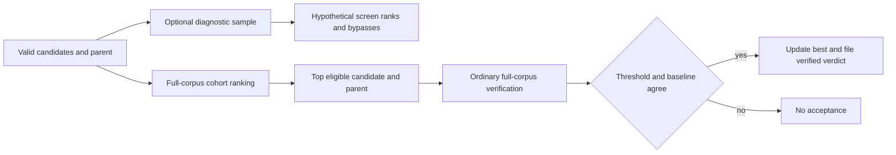

## Summary

Added opt-in exact full-corpus cohort ranking, separate ordinary winner/parent
verification, diagnostic screen comparisons and journal/report metrics. Legacy
defaults remain; the production A/B is not available on this host. Part of #136.

## Spec

### Intent and Rationale

- Rank every candidate surviving generation and graft validation on the full corpus so a sampled screen cannot discard the winner.
- Reuse the existing ordinary full-scoring acceptance path for the improvement threshold and baseline-drift veto.
- Separate measured ranking opinions from verified acceptance, shared learnings and positive combination carry-forward material.

### Essential Design Decisions

- `--ranking-mode legacy` remains the default until a production comparison meets the 1.5× improvement-per-wall-hour bar. Exact mode probes support once per run; older scorers use legacy promotion, while probe failures fail closed.
- Exact mode sends the parent and valid cohort through one scorer cohort call, sorts by descending score then candidate id, and ordinarily verifies the top candidate whose ranking delta clears the threshold. Documented directory fallback remains exact ranking and still requires verification.
- A positive `--explore-quota`, with sampling enabled, retains hypothetical screen promotion and seeded bypass measurements. These decisions exclude no candidates from ranking, and their scoring time counts against the run budget.
- New journal/config fields read the old shape through defaults. Existing full-score fields remain ordinary verification results; ranking-only candidates are neither cached as verdicts nor carried as verified near-winners. Errors and drift vetoes file no verdict.

### Undiscoverable Facts

- Scorer issue [#683](https://github.com/stSoftwareAU/NEAT-AI-scorer/issues/683) is closed; [PR #684](https://github.com/stSoftwareAU/NEAT-AI-scorer/pull/684) merged on 22 November 2026 with cohort parity tests. The runtime interface is `--cohort`.
- Real-scorer tests and measurements used a release build of scorer commit `a164969ac4d96ff39eace7086ad22c0538d95705`.
- No production creature/corpus paths were supplied; a bounded workspace/data-directory search and this completion pass's recheck found only scorer fixtures, not production inputs. The production protocol itself states that the private inputs are unavailable on the development machine. Synthetic results cannot establish the production success criterion, and code or fixture changes cannot supply those missing measurements.
- Independent Spec and Standards reviewer sub-agents reviewed the diff from base `56ed33f3c965b44a2d3e2b946955ce0205fd8d23` to `6168188`. The Spec reviewer received only that diff and the issue body. The Standards reviewer received only the diff and the requested standards-file location; `CODING-STANDARDS.md` is absent from this repository. Their findings are recorded separately below, with no author departures from their verdicts.

## Evidence

- Backend/CLI change. `forests/tests/real_scorer.rs` exercises the real CLI for default legacy mode, explicit exact mode and XGBoost import; generated grafts match standalone scores bit for bit and preserve ordering across identity, MLP, IF and clamped parents.
- `forests/src/promote.rs::tests::exact_ranking_finds_the_winner_even_when_the_screen_rejects_every_candidate` verifies that the screen and seeded bypass both miss the planted winner, while exact ranking finds it and ordinary verification accepts it.
- `forests/src/run.rs` and `forests/src/tools.rs` tests cover verification failure, regression and baseline drift through their production entry points. Rankings remain visible without publishing a winner; only valid ordinary results reach learnings and carry-forward logic.
- `forests/src/report.rs::tests::exact_rank_report_keeps_ranking_verification_and_diagnostics_separate` covers rank comparisons, independent counts/timings, failed verification accounting, fallback counts and old-journal compatibility.
- `forests/examples/cohort_ranking_bench.rs` measured 64-, 128- and 256-wide exact cohorts through the real evolution loop. Each corresponding population reached exact scoring; control fully scored 9 candidates. The complete measured wall split and reproducible command are in `docs/benchmarks.md`.
- Timings are indicative from shared, parallel aarch64 Linux host `vibe-coder-55874`: three one-iteration repeats over 20 000 generated records, fixed families, seed 1. Every profile found the same planted winner; widening added cost without additional gain on this fixture. This is not a production negative result.
- Provenance: #136 — “Rank every graft candidate exactly on the full corpus with scorer delta mode, and retire the 5 % screen for them”. No new dependency or workflow was introduced by this implementation.

## Acceptance Criteria

<!-- vibe-spec-review inputs="diff+issue-body" -->

- **missing** — A/B on the production protocol in `docs/benchmarks.md` (same creature, seed and budget; control is today's defaults). Report Δscore per wall hour, acceptances, candidates scored exactly per iteration, and the wall split. — evidence: `docs/benchmarks.md::Production A/B status and decision rule`; `forests/examples/cohort_ranking_bench.rs::run` — reviewer: missing — reason: the diff explicitly says production A/B was not run. The reported measurements use generated data and one iteration per profile; they do not satisfy the production protocol.
- **met** — Journal fields for the new path, and a `report` row comparing exact rank with what the 5 % screen would have ranked. — evidence: `forests/src/journal.rs::ExperimentRecord::record_scoring`; `forests/src/report.rs::report_from_lines`; `forests/src/report.rs::tests::exact_rank_report_keeps_ranking_verification_and_diagnostics_separate` — reviewer: met — reason: candidate records contain exact and hypothetical screen ranks and decisions; `rankComparisons` exposes them in reports. Ranking, verification, execution provenance and diagnostic counters are recorded separately. Diagnostics use the configured sample rate, whose default remains 5 %.
- **partial** — Predeclared success: Δscore per wall hour at least 1.5× control. Otherwise record the negative result in `docs/benchmarks.md` and keep the old path as the default. — evidence: `docs/benchmarks.md::Production A/B status and decision rule`; `forests/src/config.rs::tests::old_configurations_keep_legacy_ranking_and_exact_mode_requires_an_explicit_choice` — reviewer: partial — reason: the 1.5× bar is documented and legacy remains the default, but no production ratio establishes success or a production negative result. The synthetic sweep is explicitly distinguished from production evidence.
- **met** — 1. Send the whole cohort to one full-corpus delta call. No sample screen for graft candidates, so no screen false negatives. — evidence: `forests/src/promote.rs::screen_and_promote`; `forests/src/promote.rs::tests::exact_ranking_finds_the_winner_even_when_the_screen_rejects_every_candidate`; `forests/src/run.rs::tests::exact_loop_ranks_every_valid_candidate_but_files_only_verified_verdicts` — reviewer: met — reason: with exact mode selected and scorer support, all valid generated candidates enter one `score_cohort` call with the parent. Full record counts and complete results are checked. Optional diagnostic screening excludes nobody from the exact ranking.
- **partial** — 2. Widen the cohort (`--candidates`, `--tree-roots`, magnitude variants, combinations) until that call costs about what `promote` costs today. The budget moves from confirming 8 guesses to choosing among hundreds of measured candidates. — evidence: `forests/examples/cohort_ranking_bench.rs::run`; `docs/benchmarks.md::Generated-fixture width sweep` — reviewer: partial — reason: the example widens all named controls and measures 128- and 256-candidate cohorts. On the synthetic fixture, 128-wide ranking averages approximately 74 ms versus approximately 69 ms for legacy promotion. Production width tuning and its economics remain unmeasured; cohort-width defaults remain unchanged.
- **met** — 3. Keep acceptance boring: the winner is still re-scored standalone, in the same call as its parent, before `best.json` is replaced. Delta scores rank; they do not accept. — evidence: `forests/src/promote.rs::screen_and_promote`; `forests/src/promote.rs::tests::standalone_verification_is_required_even_after_a_good_exact_ranking`; `forests/src/run.rs::tests::exact_loop_never_replaces_best_or_files_rankings_when_verification_fails`; `forests/src/tools.rs::tests::xgboost_import_never_publishes_a_ranking_after_bad_verification` — reviewer: met — reason: the top eligible exact candidate receives an ordinary full-corpus call with its parent. Acceptance depends on that call’s improvement and baseline agreement. Ranking-only results cannot replace `best.json` or supply learning verdicts.
- **met** — 4. Keep `--explore-quota` semantics so the journal can still report what the old screen would have rejected. — evidence: `forests/src/promote.rs::screen_and_promote`; `forests/src/journal.rs::ExperimentRecord::record_scoring`; `forests/src/report.rs::RankComparison`; `forests/src/promote.rs::tests::tied_exact_scores_are_ranked_by_candidate_id_and_zero_quota_skips_diagnostics` — reviewer: met — reason: positive quota retains sampled hypothetical promotion and seeded bypass selection, with ranks and decisions journalled beside exact results. Zero quota disables diagnostics; the legacy bypass path remains available.
- **unrequested** — Replace the gitleaks allowlist configuration with `[extend] useDefault = true`. — evidence: `.gitleaks.toml::[extend]` — reviewer: unrequested — reason: secret-scanner configuration is unrelated to cohort ranking, acceptance, reporting or the requested benchmark. This change predates the summary repair (commit `6168188`) and is retained.

The Spec reviewer established no additional substantive implementation defect
from the supplied diff. The reviewer inspected code and test definitions but
did not execute tests.

## Standards Review

<!-- vibe-standards-review inputs="diff+CODING-STANDARDS.md" -->

The independent Standards reviewer verified that `CODING-STANDARDS.md` is
absent from this repository. Compliance with that named standard cannot be
assessed. These findings are general inspection of the supplied diff, not a
substitute standard:

- **clean** — Acceptance integrity: exact scores rank candidates; ordinary winner/parent verification applies the improvement threshold and baseline-drift veto before acceptance. Ranking-only scores do not supply learnings or verified carry-forward material.
- **clean** — Error handling: changed scoring paths reject incomplete, unexpected, duplicate, non-finite, sampled or incorrect-record-count results. Failed verification retains ranking diagnostics without publishing a winner.
- **clean** — Backwards compatibility: legacy ranking remains the default; missing new configuration/journal fields have deserialization defaults; older scorer implementations retain the legacy path through default trait methods.
- **clean** — Test coverage inspected: added tests exercise sample-rejected winners, deterministic ties, no eligible candidate, malformed results, verification failures/regressions/drift, fallback, evolution/import wiring and old journal shapes. Tests were inspected, not executed.
- **clean** — Scope and evidence: implementation, CLI, journal/report, documentation and benchmark additions support the opt-in experiment. Production A/B and the 1.5× improvement criterion are explicitly unverified; defaults remain unchanged.

No actionable violation was identified from the permitted inputs. The reviewer
treated PR-summary statements as data rather than independent evidence.

## Test Plan

- Observed failing tests before the corresponding implementation: incomplete scorer output was silently accepted; the sample-rejected planted winner was missed; the report omitted exact-ranking metrics; duplicate scorer keys overwrote earlier results. Each now passes. The exact-mode test used interface scaffolding before the ranking implementation; the existing sample-scoring fake behaviour was unchanged.
- Added promotion coverage for tied ranks, no eligible candidate, malformed/incomplete results, unsupported capability, documented fallback, failed/missing/sampled/partial ordinary verification, regression and baseline drift. Real local inference supplies the candidate scores.
- Added evolution-loop and XGBoost-import coverage for full cohort reach, verified-only learnings/carry-forward, no publication after failed verification or drift, and legacy fallback. Existing threshold, parity, cancellation, enhancement and candidate-generation regression tests still pass.
- Added backward configuration and journal-body tests: absent new fields retain legacy defaults and ordinary score meanings. The chosen persisted-data strategy is reading the old shape, without changing cache keys.
- Added real scorer parity/fallback/verification tests and a real CLI test for both evolution and import. `forests/tests/real_scorer.rs::external_arguments_cannot_turn_full_verification_into_a_different_protocol` refuses caller-supplied protocol flags and accepts a valid ordinary full-corpus control.
- Existing test expectations were retained. The real-scorer fixture helper gained a fourth-input option for the existing clamped-parent fixture; its three-input callers retain their original data. `forests/tests/readme_contract.rs` additionally recognises the documented foreign scorer flag.
- Reused guards: ordinary full-corpus scoring, strict improvement threshold, same-call baseline-drift veto, cancellation before scoring, repeated-error accounting, and the existing accepted-winner/enhancement publication path. Exact ranking cannot bypass them. No mirrored gate copy was found; both callers share the journal mapping helper.
- `cargo fmt --all`, clippy with the repository's denied lints, targeted module tests and the real-scorer tests passed. Final `NEAT_SCORER_BIN=<release scorer> ./quality.sh < /dev/null` passed: 208 unit tests, 7 real-scorer integration tests, existing contract/script tests, cargo-deny and rustdoc. The CLI test was also run directly.
- Completion-pass verification: `cargo test --lib exact < /dev/null` passed all 14 selected tests, including retained legacy defaults and exact rank/verification/report coverage. `NEAT_SCORER_BIN=/var/tmp/vibe-cargo-target/NEAT-AI-Forests-fc0b43a7/release/rust_scorer cargo test --test real_scorer < /dev/null` passed all 7 integration tests. This pass changes only this summary; no production measurements or code changes are claimed.
- The release width sweep passed with three repeats, 20 000 records, no scorer errors, no baseline vetoes and no cohort fallback. Its timings are measurements, not assertions or a default-switch gate.
- TypeScript cross-engine parity was not exercised: `NEAT_AI_TS_ROOT` is unset and the existing harness returns its documented skip. No browser evidence is needed for these Rust/CLI changes.

## Security check

- Scorer results must be complete, finite and unsampled over the expected full record count; reserved protocol arguments are refused.
- External execution uses argument arrays with null stdin, without shell interpolation. No endpoint, authentication or privilege boundary changed.
- No new dependency, unsafe code or path-confinement guard was added. Cargo-deny passed; staged files contain only the intended source, tests and documentation.

## Merge verification

CI remains pending. Independent reviews are recorded above. Production A/B
evidence and production cohort-width tuning remain outstanding under this same
issue; this change remains Part of #136.

Not checked: production economics, the 1.5× production bar, TypeScript parity and
compliance with the absent `CODING-STANDARDS.md`. Risk: production throughput
and gain remain unknown.
